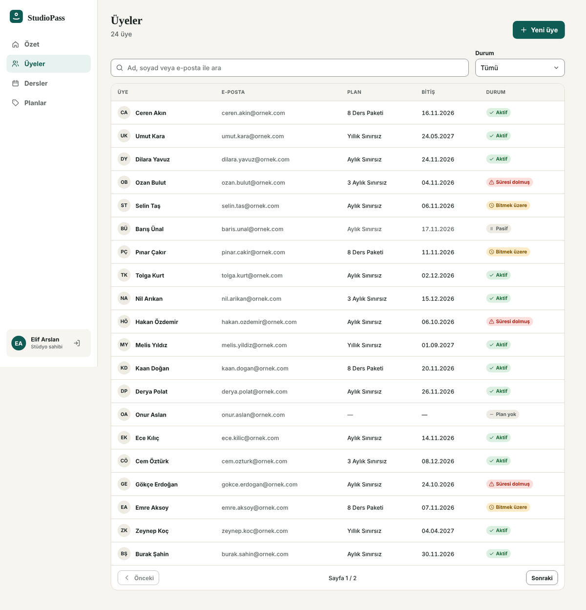
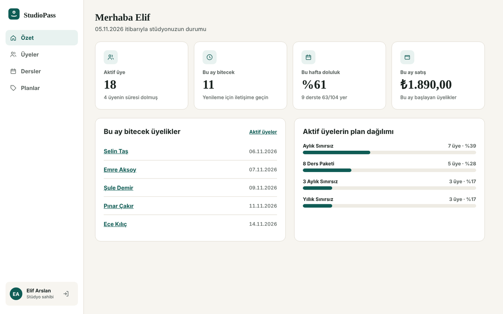
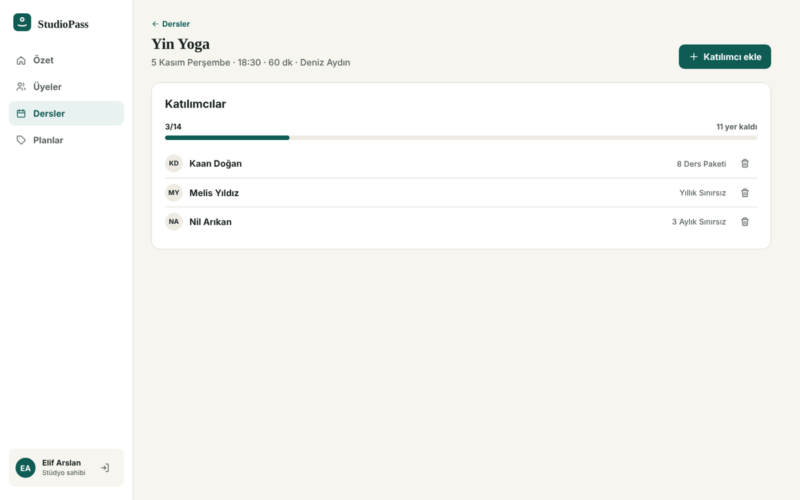
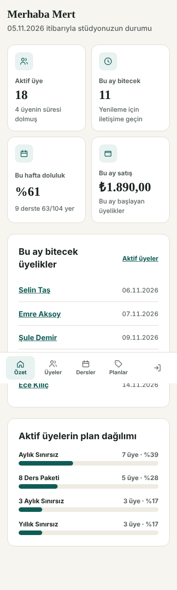
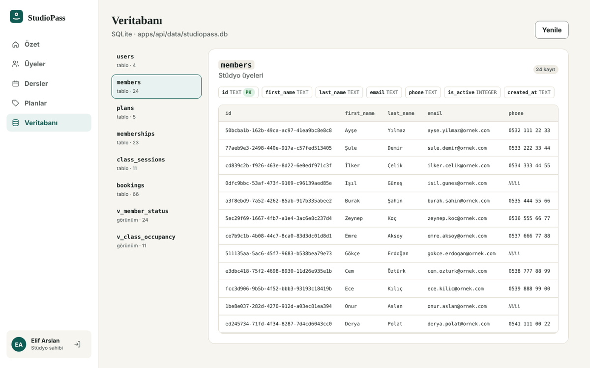

<div align="center">

# StudioPass

**Butik spor, yoga ve pilates stüdyoları için üyelik ve abonelik yönetim paneli (SaaS)**

İhtiyaç analizinden tasarıma, geliştirmeden kabul testine kadar **uçtan uca** belgelenmiş bir ürün vaka çalışması.

[](https://github.com/Yaren-Dogan/studiopass/actions/workflows/ci.yml)


📄 **[Proje dokümanı (PDF)](docs/StudioPass-Proje-Dokumani.pdf)** · [Figma](https://www.figma.com/design/gKfS7dCMKRTlJrJPEh8TRU) · [Gereksinimler](docs/01-analiz/gereksinimler.md) · [Test raporu](docs/05-test/test-raporu-v1.0.md) · [Hata kayıtları](docs/05-test/hata-kayitlari/) · [Yapay zekâ kodu inceleme notları](docs/07-yapay-zeka-inceleme/inceleme-notlari.md)

</div>



## Bu depoda ne var?

Bir dijital ürün ekibinde her rolün ürettiği çıktı, aynı ürün üzerinde ve birbirine bağlı olarak:

| Rol | Çıktı | Nerede |
|---|---|---|
| **İş analisti** | Problem tanımı, paydaşlar, As-Is / To-Be süreç, gereksinimler (FR/NFR/BR), veri modeli | [`docs/01-analiz`](docs/01-analiz) |
| **Ürün sahibi** | Vizyon, yol haritası, RICE ile önceliklendirilmiş backlog, Gherkin kabul kriterleri, DoR/DoD | [`docs/02-urun`](docs/02-urun) · [hikâyeler](docs/01-analiz/kullanici-hikayeleri.md) |
| **UX/UI tasarımcı** | Personalar, yolculuk haritası, bilgi mimarisi, akışlar, tasarım sistemi, **Figma** (Variables + bileşenler + ekranlar) | [`docs/03-ux-ui`](docs/03-ux-ui) · [`design/tokens.json`](design/tokens.json) |
| **Yazılımcı** | React + TypeScript panel, Node.js REST API, SQLite veritabanı, OpenAPI/Swagger, mimari kararlar (ADR) | [`apps/`](apps) · [`docs/04-mimari`](docs/04-mimari) |
| **Test / QA** | Test planı, karar tablosu, 32 senaryo, izlenebilirlik matrisi, **8 hata kaydı**, erişilebilirlik denetimi, tasarım↔uygulama karşılaştırması, 126 otomatik test | [`docs/05-test`](docs/05-test) |
| **Proje koordinasyonu** | Proje planı (Gantt), RACI, risk kaydı, haftalık durum raporu, toplantı notları, sürüm notları | [`docs/06-proje-yonetimi`](docs/06-proje-yonetimi) · [`CHANGELOG.md`](CHANGELOG.md) |
| **Yapay zekâ ile üretilen işin denetimi** | İncelemede yakalanan 6 gerçek sorun: yanlış pozitif test, StrictMode'da kırılan düzeltme, adsız menü bağlantıları… | [`docs/07-yapay-zeka-inceleme`](docs/07-yapay-zeka-inceleme/inceleme-notlari.md) |

## Ürün

Stüdyolar üyeliklerini Excel ve WhatsApp'ta takip ediyor; süresi biten üyeler derse girmeye devam ediyor, dersler çifte rezerve ediliyor. StudioPass kuralları **sunucuda** uygular:

- **Roller:** Stüdyo sahibi · Yönetici · Eğitmen (eğitmen, KVKK gereği üye iletişim bilgilerini göremez; API yanıtında da yoktur)
- **Üyeler:** Türkçe karakter duyarsız arama (`AYŞE` = `ayse`), durum filtresi, plan atama ve otomatik bitiş tarihi
- **Dersler ve rezervasyon:** kapasite, aktif üyelik, mükerrer kayıt ve geçmiş ders kuralları ([karar tablosu](docs/05-test/test-plani.md#rezervasyon-karar-tablosu-fr-10))
- **Özet panel:** aktif üye, bu ay bitecek üyelikler, haftalık doluluk, plan dağılımı

| Özet | Ders detayı | Mobil |
|---|---|---|
|  |  |  |

## Hızlı başlangıç

```bash
npm install
npm run dev          # API → http://localhost:4000 · Web → http://localhost:5173
```

| Hesap | Rol | Şifre |
|---|---|---|
| `elif@studiopass.dev` | Stüdyo sahibi | `Studio123!` |
| `mert@studiopass.dev` | Yönetici | `Studio123!` |
| `deniz@studiopass.dev` | Eğitmen | `Studio123!` |

**Swagger UI:** http://localhost:4000/docs — `POST /api/auth/login` ile token alıp **Authorize**'a yapıştırın.

### Veritabanı
Veriler **SQLite** dosyasında saklanır: `apps/api/data/studiopass.db` (ilk çalıştırmada demo verisiyle oluşur, sunucu kapansa da silinmez). Ek kurulum gerekmez.

- **Panelde:** `elif@studiopass.dev` ile giriş yap → sol menüde **Veritabanı** (tablolar, sütunlar, PK/FK ve satırlar; yalnız stüdyo sahibine açık)
- **Görsel program:** [DB Browser for SQLite](https://sqlitebrowser.org/dl/) ile dosyayı aç → *Browse Data*
- **Terminal:** `npm run db:tablolar` (tablolar ve örnek satırlar) · `npm run db:sifirla` (demo verisine dön)



Tablolar, kısıtlar, görünümler ve örnek SQL sorguları: [docs/04-mimari/veritabani.md](docs/04-mimari/veritabani.md)

## Testler

```bash
npm test                 # API + veritabanı (53) + web birim (20)
npm run e2e              # Playwright: masaüstü Chrome + mobil 390 px (38)
npm run check:contrast   # Tasarım token kontrastı, WCAG 2.2 AA
npm run lint             # TypeScript strict
```

Her test bir kabul kriterine bağlıdır (`TC-xx`). Hangi gereksinimin hangi testle korunduğu: [izlenebilirlik matrisi](docs/05-test/izlenebilirlik-matrisi.md).

## Proje yapısı

```
apps/
  api/        Node.js 22 REST API (çalışma zamanı bağımlılığı yok) · SQLite (src/db) · openapi.yaml · node:test
  web/        React 19 + TypeScript · esbuild · Playwright e2e
design/       tokens.json (Figma Variables ile birebir)
docs/
  01-analiz/              iş analizi, gereksinimler, kullanıcı hikâyeleri
  02-urun/                vizyon, yol haritası, backlog, DoR/DoD
  03-ux-ui/               araştırma, bilgi mimarisi, tasarım sistemi, Figma
  04-mimari/              mimari, ADR'ler
  05-test/                test planı, senaryolar, hata kayıtları, denetimler, raporlar
  06-proje-yonetimi/      plan, RACI, riskler, haftalık raporlar, toplantı notları
  07-yapay-zeka-inceleme/ yapay zekâ ile üretilen kodun inceleme notları
.github/      CI, issue şablonları (hata, hikâye), PR kontrol listesi
```

## Nasıl çalışıldı?

- **Yapay zekâ destekli geliştirme:** Kodun büyük kısmı yapay zekâ ile yazıldı. Kalite; kabul kriterlerinden türetilen testler, satır satır test incelemesi, keşif testi ve erişilebilirlik denetimiyle güvenceye alındı. Yakalanan sorunlar ve dersler: [inceleme notları](docs/07-yapay-zeka-inceleme/inceleme-notlari.md).
- **Belgeli ilerleme:** Kararlar ADR ve toplantı notlarında, dokümanlar kodla birlikte sürümlü.
- **Erişilebilirlik bir kabul kriteri:** Klavye, odak, kontrast, durum mesajları ve hedef boyutu otomatik test ediliyor.

> 📌 **Vaka çalışması notu:** StudioPass bir portfolyo projesidir. Analiz dokümanlarındaki görüşme verileri, müşteri adları, sprint takvimi ve toplantılar örnek senaryodur. Kod, testler, hata kayıtları, denetimler ve inceleme notları bu depodaki gerçek çalışmadır.

---

Hazırlayan: **Yaren Doğan** · [GitHub](https://github.com/Yaren-Dogan)
