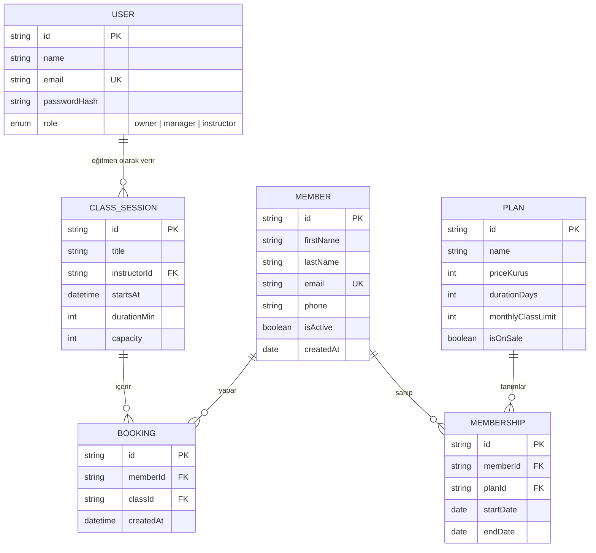

# Gereksinim Dokümanı (SRS) — StudioPass v1.0

| Alan | Bilgi |
|---|---|
| Sürüm | 1.3 |
| Durum | Onaylandı |
| İzlenebilirlik | Her gereksinim bir kullanıcı hikâyesine ve test senaryosuna bağlıdır |

## 1. Roller ve yetkiler

| Yetki | Sahip | Yönetici | Eğitmen |
|---|:---:|:---:|:---:|
| Özet paneli görme | ✅ | ✅ | ❌ |
| Üyeleri listeleme | ✅ | ✅ | ✅ (sadece ad ve plan) |
| Üye iletişim bilgisi görme | ✅ | ✅ | ❌ |
| Üye ekleme / düzenleme | ✅ | ✅ | ❌ |
| Üyeyi pasife alma | ✅ | ✅ | ❌ |
| Plan oluşturma / düzenleme | ✅ | ❌ | ❌ |
| Plan görüntüleme | ✅ | ✅ | ✅ |
| Ders oluşturma | ✅ | ✅ | ❌ |
| Ders rezervasyonu yapma | ✅ | ✅ | ✅ (kendi dersine) |

## 2. Fonksiyonel gereksinimler

| Kod | Gereksinim | Öncelik | Hikâye | Test |
|---|---|---|---|---|
| FR-01 | Kullanıcı e-posta ve şifreyle giriş yapabilmelidir. Hatalı denemede genel bir hata mesajı gösterilmelidir (hangi alanın hatalı olduğu söylenmez). | Must | US-01 | TC-01..03 |
| FR-02 | Oturum 8 saat geçerli olmalı, süre dolunca kullanıcı giriş sayfasına yönlendirilmelidir. | Must | US-01 | TC-04 |
| FR-03 | Kullanıcı sadece rolünün izin verdiği menü ve işlemleri görmelidir; API de aynı kuralı uygulamalıdır. | Must | US-02 | TC-05..07 |
| FR-04 | Üye listesi ad/soyad ve e-postaya göre aranabilmeli, duruma (aktif, süresi dolmuş, pasif) göre filtrelenebilmelidir. | Must | US-03 | TC-08..10 |
| FR-05 | Yeni üye eklerken ad, soyad, e-posta zorunlu; telefon isteğe bağlıdır. E-posta benzersiz olmalıdır. | Must | US-04 | TC-11..14 |
| FR-06 | Üyeye plan atandığında bitiş tarihi = başlangıç tarihi + plan süresi (gün) olarak hesaplanmalıdır. | Must | US-05 | TC-15..16 |
| FR-07 | Üyelik durumu bitiş tarihine göre otomatik hesaplanmalıdır: bitiş ≥ bugün → Aktif; bitiş < bugün → Süresi dolmuş. | Must | US-05 | TC-17 |
| FR-08 | Sahip abonelik planı oluşturabilmelidir: ad, fiyat (TL), süre (gün), aylık ders hakkı. | Must | US-06 | TC-18..20 |
| FR-09 | Ders oluşturulurken ad, eğitmen, tarih-saat, süre (dk) ve kapasite zorunludur. Kapasite 1-50 arasındadır. | Must | US-07 | TC-21..22 |
| FR-10 | Rezervasyon sadece aktif üyelik için yapılabilir; kapasite doluysa reddedilir; aynı üye aynı derse iki kez yazılamaz. | Must | US-08 | TC-23..26 |
| FR-11 | Özet panel; aktif üye sayısı, bu ay bitecek üyelikler, bu haftanın doluluk oranı ve plan dağılımını göstermelidir. | Should | US-09 | TC-27 |
| FR-12 | Üye pasife alınabilir; pasif üye listede gri gösterilir, rezervasyon yapamaz, silinmez. | Should | US-10 | TC-28 |
| FR-13 | Listeler 20'şer kayıt sayfalanmalıdır. | Could | US-03 | TC-29 |

## 3. Fonksiyonel olmayan gereksinimler

| Kod | Kategori | Gereksinim |
|---|---|---|
| NFR-01 | Performans | Liste API yanıtları 1.000 kayıtta p95 < 300 ms |
| NFR-02 | Güvenlik | Şifreler bcrypt ile saklanır; JWT 8 saat; tüm uç noktalar rol kontrolünden geçer |
| NFR-03 | Güvenlik | Hata yanıtları iç ayrıntı (stack trace) içermez |
| NFR-04 | Erişilebilirlik | WCAG 2.2 AA: kontrast ≥ 4.5:1, klavye ile tam kullanım, görünür odak, form hataları ekran okuyucuya duyurulur |
| NFR-05 | Uyumluluk | Chrome, Safari, Firefox, Edge son 2 sürüm; 360 px genişliğe kadar duyarlı |
| NFR-06 | Yerelleştirme | Arayüz Türkçe; tarih `GG.AA.YYYY`, para birimi `₺1.250,00` biçiminde |
| NFR-07 | Gözlemlenebilirlik | Her API isteği yöntem, yol, durum kodu ve süreyle loglanır |
| NFR-08 | Kalite | Ana akışlar uçtan uca testlerle korunur; CI'da her PR'da çalışır |

## 4. İş kuralları

| Kod | Kural |
|---|---|
| BR-01 | Bir üyenin aynı anda tek aktif planı olabilir. Yeni plan atanırsa eskisi kapanır. |
| BR-02 | Fiyatlar KDV dahil girilir ve kuruş hassasiyetinde saklanır (tamsayı kuruş). |
| BR-03 | Geçmiş tarihli derse rezervasyon yapılamaz. |
| BR-04 | Plan silinemez, sadece satıştan kaldırılır (pasif). Mevcut üyelikler etkilenmez. |
| BR-05 | "Bu ay bitecek" = bitiş tarihi bugünden ayın son gününe kadar olan aktif üyelikler. |

## 5. Veri modeli

## 6. İzlenebilirlik matrisi
Gereksinim → Hikâye → Test senaryosu → Otomasyon eşleşmesi: [`../05-test/izlenebilirlik-matrisi.md`](../05-test/izlenebilirlik-matrisi.md)
