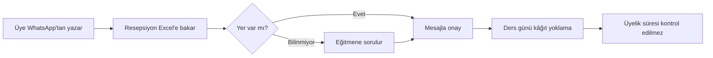
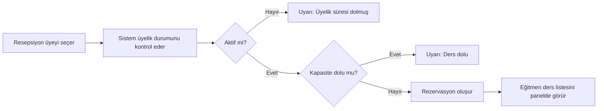

# İş Analizi — StudioPass

> 📌 **Vaka çalışması notu:** StudioPass bir portfolyo projesidir. Görüşme sayıları, katılımcılar ve alıntılar, gerçek bir ihtiyaç analizinin nasıl belgeleneceğini göstermek için hazırlanmış **örnek verilerdir**.

| Alan | Bilgi |
|---|---|
| Doküman sürümü | 1.2 |
| Durum | Onaylandı |
| Son güncelleme | 2026-10-14 |
| Hazırlayan | İş Analisti / Ürün Sahibi |

## 1. Problem tanımı

Türkiye'deki küçük ve orta ölçekli spor, yoga ve pilates stüdyoları üyeliklerini çoğunlukla **Excel tabloları, WhatsApp grupları ve kâğıt yoklama listeleriyle** yönetiyor. 12 stüdyo sahibiyle yaptığımız görüşmelerde öne çıkan sorunlar:

| # | Sorun | Etki | Görüşmelerde dile getiren |
|---|---|---|---|
| P1 | Üyeliği biten üyeler derslere katılmaya devam ediyor | Aylık ortalama %8 gelir kaybı | 9 / 12 |
| P2 | Ders kapasitesi WhatsApp'tan takip ediliyor, çifte rezervasyon oluyor | Müşteri şikâyeti, kayıp üye | 7 / 12 |
| P3 | Eğitmen hangi derste kimin olduğunu bilmiyor | Yoklama 10-15 dk sürüyor | 6 / 12 |
| P4 | Sahip, hangi planın daha çok sattığını göremiyor | Fiyatlandırma kararları sezgiyle alınıyor | 8 / 12 |
| P5 | Personelin hangi verilere erişebileceği kontrol edilemiyor | KVKK riski | 5 / 12 |

## 2. Hedefler ve başarı ölçütleri

| Hedef | Ölçüt (KPI) | Hedef değer (ilk 6 ay) |
|---|---|---|
| Üyeliği biten kişinin derse katılmasını engellemek | Süresi geçmiş üyelikle yapılan rezervasyon oranı | %0 |
| Kapasite yönetimini dijitalleştirmek | Çifte rezervasyon sayısı | Ayda 0 |
| Yoklamayı hızlandırmak | Ders başı yoklama süresi | < 2 dk |
| Sahibe görünürlük sağlamak | Özet panelini haftada en az 1 kez açan sahip oranı | > %70 |
| Erişimi rol bazlı sınırlandırmak | Yetkisiz erişim olayı | 0 |

## 3. Paydaşlar

| Paydaş | İlgisi | Etkisi | İletişim sıklığı |
|---|---|---|---|
| Stüdyo sahibi | Gelir, doluluk, maliyet | Yüksek | Haftalık demo |
| Stüdyo yöneticisi / resepsiyon | Günlük üye işlemleri | Yüksek | Sprint incelemesi |
| Eğitmen | Ders listesi, yoklama | Orta | Ayda bir görüşme |
| Üye | Rezervasyon, plan bilgisi | Orta | Kullanılabilirlik testi |
| Geliştirme ekibi | Net gereksinim, kararlar | Yüksek | Günlük |

## 4. Kapsam

### Kapsam içi (MVP — v1.0)
- E-posta ve şifre ile giriş, rol bazlı yetkilendirme (Sahip, Yönetici, Eğitmen)
- Üye yönetimi: listeleme, arama, filtreleme, ekleme, düzenleme, pasife alma
- Abonelik planları: oluşturma, fiyat ve süre tanımlama, üyeye plan atama
- Ders takvimi: ders oluşturma, kapasite, eğitmen atama, rezervasyon
- Özet panel: aktif üye, bu ay biten üyelik, haftalık doluluk, plan dağılımı
- Türkçe arayüz, WCAG 2.2 AA uyumu

### Kapsam dışı (sonraki sürümler)
- Online ödeme (iyzico/Stripe entegrasyonu) → v1.2
- Üye mobil uygulaması → v2.0
- Çoklu şube → v2.0
- SMS / e-posta bildirimleri → v1.1

## 5. Mevcut süreç (As-Is) ve hedef süreç (To-Be)

### As-Is: Derse katılım

### To-Be: Derse katılım

## 6. Varsayımlar ve kısıtlar
- Stüdyoların %90'ı masaüstü ya da tabletten resepsiyon işlemi yapıyor; panel önce masaüstü ve tablet için tasarlanır, mobilde de kullanılabilir olmalıdır.
- MVP'de tek stüdyo (tek kiracı) yapısı yeterlidir; veri modeli çoklu kiracıya açık tasarlanır.
- Kişisel veriler KVKK kapsamındadır; eğitmen rolü üyelerin telefon ve e-posta bilgisini göremez.

## 7. Riskler
Ayrıntılı risk kaydı: [`../06-proje-yonetimi/risk-kaydi.md`](../06-proje-yonetimi/risk-kaydi.md)
