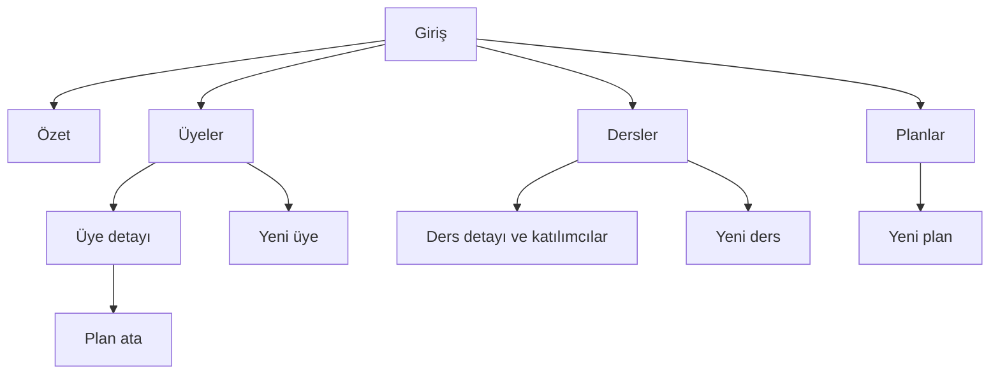
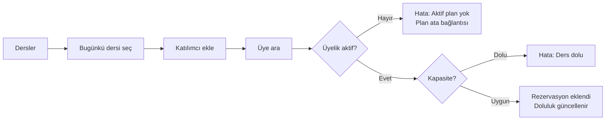
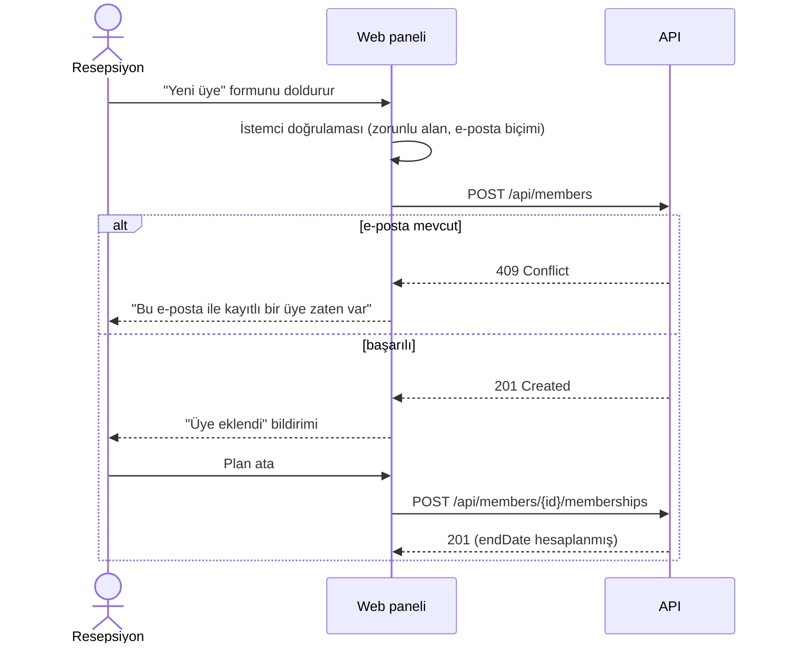

# Bilgi Mimarisi ve Kullanıcı Akışları

> 📌 Ölçüm değerleri (tıklama süresi) vaka çalışmasının örnek kullanılabilirlik testine aittir.

## Site haritası

Menü sırası kart sıralama sonucuna göre: **Özet · Üyeler · Dersler · Planlar**. Eğitmen girişinde varsayılan sayfa **Dersler**'dir.

## Akış 1 — Üyeyi derse yazma (resepsiyon, en sık görev)

Hedef: **3 tıklama** (Ders → Katılımcı ekle → Üye seç). Ölçülen: 3 tıklama, ortalama 11 sn (kullanılabilirlik testi).

## Akış 2 — Yeni üye ve plan

## Ekran envanteri

| Kod | Ekran | Roller | Durumlar |
|---|---|---|---|
| S-01 | Giriş | Herkes | Varsayılan, doğrulama hatası, sunucu hatası, yükleniyor |
| S-02 | Özet | Sahip, Yönetici | Veri var, boş stüdyo, yükleniyor |
| S-03 | Üye listesi | Herkes (eğitmen kısıtlı) | Liste, arama sonucu yok, boş, yükleniyor, hata |
| S-04 | Yeni üye (yan panel) | Sahip, Yönetici | Varsayılan, doğrulama hatası, mükerrer e-posta |
| S-05 | Üye detayı + plan ata | Sahip, Yönetici | Aktif, süresi dolmuş, pasif |
| S-06 | Ders listesi (haftalık) | Herkes | Dersler, boş hafta |
| S-07 | Ders detayı + katılımcılar | Herkes | Yer var, %90+, dolu, geçmiş ders |
| S-08 | Planlar | Herkes (düzenleme sadece sahip) | Liste, satış dışı plan |
