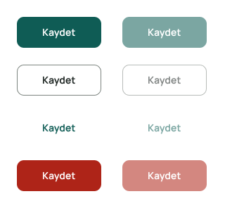
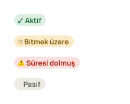
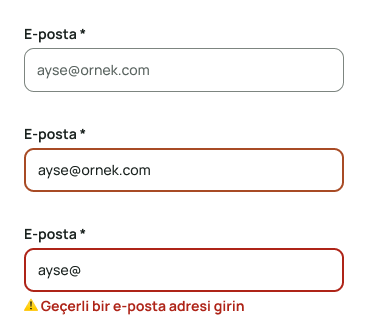
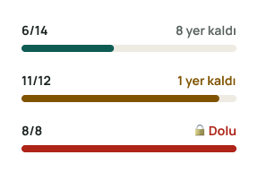
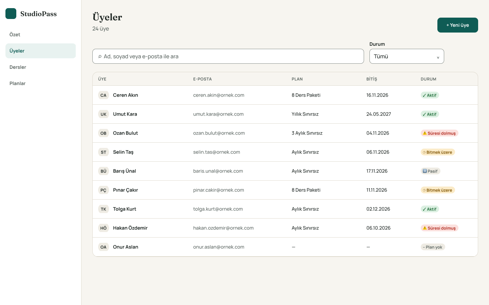
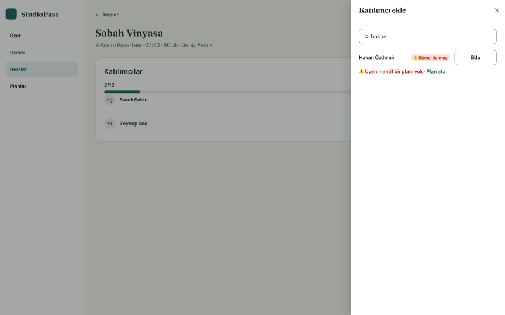

# Figma Dosyası

🔗 **[StudioPass — Tasarım (Figma)](https://www.figma.com/design/gKfS7dCMKRTlJrJPEh8TRU)**

## Sayfalar

| Sayfa | İçerik |
|---|---|
| 00 Kapak | Proje kapağı |
| 01 Tasarım sistemi | Değişkenler (Variables), metin stilleri, bileşenler |
| 02 Ekranlar | S-03 Üyeler (1440) · S-07 Ders detayı + Katılımcı ekle paneli, hata durumu (1440) |

## Değişkenler (Variables)

Kod ile birebir aynı adlar ve **code syntax** (`var(--...)`) tanımlıdır; Figma'da bir değişkeni seçince Dev Mode'da CSS karşılığı görünür.

| Koleksiyon | İçerik | Kod |
|---|---|---|
| Primitives | 20 ham renk (`teal/700`, `sand/50`…) — gizli kapsam, doğrudan kullanılmaz | – |
| Color (Light) | 18 semantik renk, primitive'lere alias: `bg/*`, `text/*`, `border/*`, `action/*`, `status/*` | `apps/web/src/styles/tokens.css` |
| Spacing & Radius | 4 px ölçeği (`spacing/1…12`), `radius/sm·md·lg·pill` | aynı dosya |

Her değişkenin kapsamı (scope) sınırlıdır: metin renkleri yalnız metinde, kenar renkleri yalnız kenarda seçilebilir.

## Metin stilleri
Display · Başlık 1 (Fraunces SemiBold) · Başlık 2 · Gövde · Küçük · Küçük kalın · Etiket (Manrope). Değerler [tasarım sistemi](tasarim-sistemi.md) tablosuyla aynıdır.

## Bileşenler

| Bileşen | Varyantlar | Kod karşılığı |
|---|---|---|
| Button | `Style` = primary · secondary · ghost · danger × `State` = Default · Disabled; `Label` metin özelliği | `ui.tsx › Button` |
| Badge | `Tone` = active · warning · danger · neutral | `ui.tsx › Badge / StatusBadge` |
| TextField | `State` = Default · Focus · Error | `ui.tsx › TextField` |
| CapacityBar | `Level` = normal · high · full | `ui.tsx › CapacityBar` |

| Button | Badge | TextField | CapacityBar |
|---|---|---|---|
|  |  |  |  |

## Ekranlar

**S-03 Üyeler**

**S-07 Ders detayı — süresi dolmuş üye eklenmeye çalışılınca**

## Tasarım → kod akışı
1. Ekran Figma'da `02 Ekranlar` sayfasında hazırlanır, kabul kriterleri kare açıklamasına yazılır.
2. Hazır olunca issue'ya Figma kare bağlantısı eklenir (DoR).
3. Geliştirme sonrası test ortamındaki ekran [karşılaştırma şablonuyla](../05-test/sablonlar/tasarim-karsilastirma-sablonu.md) kontrol edilir; farklar [karşılaştırma raporuna](../05-test/tasarim-uygulama-karsilastirma.md) yazılır.

## Sonraki adımlar
- `ClassCard` bileşeni ve `state=past` varyantı (BUG-014)
- Tablet (1024) ve mobil (390) ekran kareleri
- Prototip bağlantıları (Akış 1: üyeyi derse yaz)
