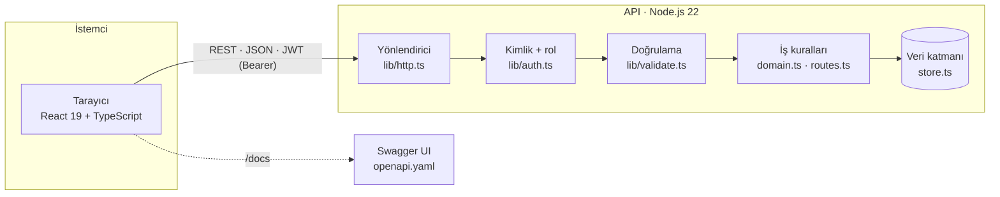

# Mimari



## Katmanlar

| Katman | Dosya | Sorumluluk |
|---|---|---|
| Yönlendirme | `apps/api/src/lib/http.ts` | Yol eşleme, gövde okuma (100 KB sınırı), hata biçimi |
| Kimlik | `lib/auth.ts` | scrypt ile şifre, HS256 JWT (8 saat), `requireRole()` |
| Doğrulama | `lib/validate.ts` | Alan bazlı hata toplama → `400 { fields }` |
| İş kuralları | `domain.ts`, `routes.ts` | Üyelik durumu, rol bazlı görünüm, rezervasyon karar tablosu |
| Veri | `store.ts` | Bellek içi depo + tohum verisi (v1.0); arayüzü korunarak PostgreSQL'e geçilecek (ADR-004) |
| Ön yüz | `apps/web/src` | Sayfalar, bileşenler (Figma ile aynı adlar), API istemcisi, yönlendirici |

## Hata sözleşmesi
Tüm hatalar aynı biçimdedir; ön yüz alan hatalarını `fields` üzerinden ilgili inputun altına yazar:
```json
{ "error": { "code": "EMAIL_TAKEN", "message": "Bu e-posta ile kayıtlı bir üye zaten var", "fields": { "email": "..." } } }
```

| Kod aralığı | Anlamı | Örnek |
|---|---|---|
| 400 | İstek biçimi / doğrulama | `VALIDATION_ERROR`, `INVALID_JSON` |
| 401 | Kimlik yok / geçersiz / süresi dolmuş | `TOKEN_EXPIRED` |
| 403 | Rol yetkisi yok | `FORBIDDEN` |
| 404 | Kaynak yok | `MEMBER_NOT_FOUND` |
| 409 | Çakışma | `EMAIL_TAKEN`, `CLASS_FULL`, `ALREADY_BOOKED` |
| 422 | İş kuralı | `NO_ACTIVE_MEMBERSHIP`, `CLASS_IN_PAST` |
| 500 | Beklenmeyen | `INTERNAL_ERROR` (iç ayrıntı yok) |

## Güvenlik kontrolleri
- Şifreler `scrypt` + rastgele tuz; karşılaştırma `timingSafeEqual`
- JWT imzası sabit zamanlı karşılaştırılır; süre kontrolü sunucuda
- Rol kontrolü **her** uç noktada sunucuda (arayüzdeki gizleme ek katmandır)
- Eğitmen rolünde iletişim alanları yanıttan çıkarılır, e-postada arama yapılmaz
- CORS yalnız izinli kökenler; `X-Content-Type-Options: nosniff`
- `/api/test/reset` yalnız `NODE_ENV=test` veya `E2E=1` iken tanımlı
