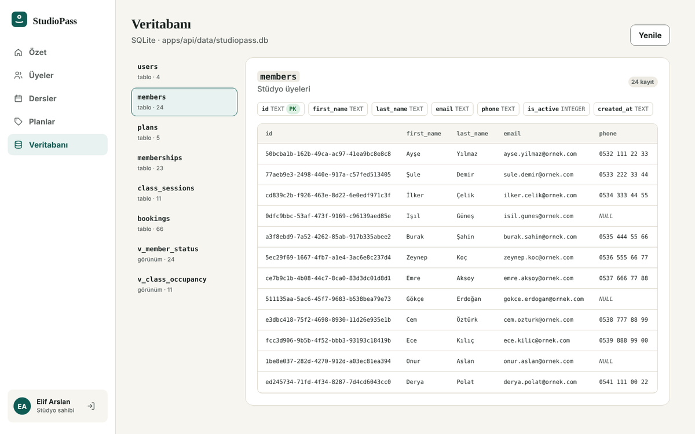

# Veritabanı (SQLite)

StudioPass verileri **SQLite** veritabanında saklar. Ek kurulum gerekmez: Node.js 22.13+ içinde gelen `node:sqlite` modülü kullanılır.

| | |
|---|---|
| Dosya | `apps/api/data/studiopass.db` (ilk çalıştırmada otomatik oluşur, Git'e eklenmez) |
| Şema | [`apps/api/src/db/schema.sql`](../../apps/api/src/db/schema.sql) |
| Kod | [`apps/api/src/db/sqlite.ts`](../../apps/api/src/db/sqlite.ts) |
| Karar | [ADR-005](kararlar/ADR-005-sqlite.md) |

## Tablolar

| Tablo | Kayıt (demo) | Açıklama | Önemli kısıtlar |
|---|---|---|---|
| `users` | 4 | Panel kullanıcıları (sahip, yönetici, eğitmen) | `email` benzersiz (büyük/küçük harf duyarsız), `role` yalnız 3 değer |
| `members` | 24 | Stüdyo üyeleri | `email` benzersiz, `is_active` 0/1 |
| `plans` | 5 | Abonelik planları | `price_kurus > 0`, `duration_days` 1–730 |
| `memberships` | 23 | Üyeye atanan plan (geçmiş dahil) | `member_id`, `plan_id` yabancı anahtar; `end_date ≥ start_date` |
| `class_sessions` | 11 | Dersler | `instructor_id` → `users`; `capacity` 1–50 |
| `bookings` | 66 | Rezervasyonlar | `(member_id, class_id)` benzersiz — aynı kişi aynı derse iki kez yazılamaz |

**Görünümler (hazır sorgular):**
- `v_member_status` — üye, e-posta, güncel plan, bitiş, durum (aktif / süresi dolmuş / plan yok / pasif)
- `v_class_occupancy` — ders, İstanbul saatiyle başlangıç, eğitmen, kayıtlı / kapasite

Para tamsayı **kuruş** olarak saklanır (`189000` = ₺1.890,00). Tarihler `YYYY-MM-DD`, saatler UTC ISO 8601 metin olarak saklanır.

```
users ──1:N──▶ class_sessions ──1:N──▶ bookings ◀──N:1── members
                                                           │
plans ──1:N──▶ memberships ◀──────────────N:1──────────────┘
```

## Veritabanını görüntüleme

### 1) Panelin içinden (en kolay)
`elif@studiopass.dev` / `Studio123!` ile giriş yap → sol menüde **Veritabanı**.
Her tablo ve görünüm; sütun tipleri, PK/FK bilgisi ve satırlarıyla gösterilir. Veriler `GET /api/admin/database` uç noktasıyla **doğrudan SQL'den** okunur (`PRAGMA table_info`, `PRAGMA foreign_key_list`, `SELECT`). Şifre özetleri gizlenir; uç nokta yalnız **stüdyo sahibi** rolüne açıktır (yönetici ve eğitmen 403 alır).



### 2) Görsel program ile
**DB Browser for SQLite** — ücretsiz, Windows/macOS/Linux: https://sqlitebrowser.org/dl/

1. API'yi en az bir kez çalıştır (`npm run dev -w @studiopass/api`) — dosya oluşur.
2. DB Browser'da **Open Database** → `studiopass/apps/api/data/studiopass.db`
3. **Browse Data** sekmesinde tablo seç (`members`, `bookings`…). Görünümler de listede.
4. **Execute SQL** sekmesinde sorgu çalıştırabilirsin (aşağıdaki örnekler).

> Alternatif: VS Code'da **SQLite Viewer** eklentisi — dosyaya çift tıklayınca tablolar açılır.
> İpucu: Panelde bir üye ekle, sonra DB Browser'da **F5** (yenile) ile yeni satırı gör.

### 3) Terminalden
```bash
npm run db:tablolar     # her tablodan kayıt sayısı + ilk 3 satır, görünümler
npm run db:sifirla      # verileri demo durumuna döndürür (tarihler bugüne göre yeniden üretilir)
```

## Örnek sorgular

```sql
-- Süresi dolmuş üyeler
SELECT * FROM v_member_status WHERE durum = 'süresi dolmuş';

-- Bu ay bitecek üyelikler
SELECT uye, plan, bitis FROM v_member_status
WHERE durum = 'aktif' AND bitis <= date('now', 'start of month', '+1 month', '-1 day')
ORDER BY bitis;

-- Ders doluluk oranı
SELECT ders, baslangic_istanbul, kayitli || '/' || kapasite AS doluluk,
       round(100.0 * kayitli / kapasite) AS yuzde
FROM v_class_occupancy;

-- Plan başına aktif üyelik sayısı ve plan bedellerinin toplamı (₺)
SELECT p.name, count(*) AS uye, printf('%.2f', sum(p.price_kurus) / 100.0) AS toplam_tl
FROM memberships ms JOIN plans p ON p.id = ms.plan_id
WHERE ms.end_date >= date('now')
GROUP BY p.name ORDER BY uye DESC;

-- Kısıt denemesi: aynı rezervasyonu ikinci kez eklemeye çalış → UNIQUE hatası
INSERT INTO bookings (id, member_id, class_id, created_at)
SELECT 'deneme', member_id, class_id, datetime('now') FROM bookings LIMIT 1;
```

## Çalışma şekli ve sınırlar
> ⚠️ **Önemli:** API çalışırken veritabanını **okumak** için aç. DB Browser'da elle yaptığın değişiklikler API'nin belleğine geçmez ve API'nin bir sonraki kaydında üzerine yazılır. Elle veri düzenlemek istersen önce API'yi durdur, değişikliği yap, **Write Changes**'a bas, sonra API'yi yeniden başlat.

- Sunucu açılırken dosyadaki veriyi okur; dosya boşsa demo verisini yazar.
- Başarılı her değişiklikten (POST/PATCH/DELETE) sonra veriler **tek işlemde** (transaction) dosyaya yazılır. Bir kısıt ihlal edilirse işlem geri alınır, bellekteki veri de son tutarlı duruma döner ve istek `500` ile sonuçlanır.
- Testler veritabanı dosyasına dokunmaz: birim testleri bellekte, uçtan uca testler ayrı bir dosyada (`data/e2e.db`, port 4100) çalışır.
- Bu yapı tek sunuculu demo/pilot ölçeği içindir. Çok kullanıcılı üretim ortamı için PostgreSQL'e geçiş ve satır bazlı sorgular planlıdır (ADR-005).
