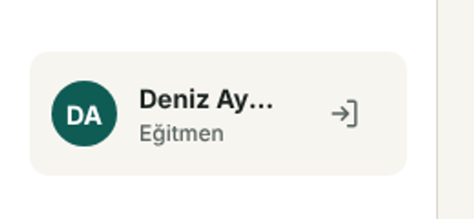

# BUG-010 · Kenar çubuğunda kullanıcı adı kesiliyor

| Alan | Değer |
|---|---|
| Önem | Düşük (görsel) · Öncelik P3 |
| Katman | Ön yüz — `app.css` `.me__name` |
| Ortam | Chrome, 1440×900 |
| İlgili | Tasarım: Bileşenler › NavItem / Me kartı |

## Adımlar
1. `deniz@studiopass.dev` ile giriş yap.
2. Sol alttaki kullanıcı kartına bak.

## Beklenen
Tasarım spesifikasyonundaki gibi ad tam görünür: **Deniz Aydın**.

## Gerçekleşen
Ad **"Deniz Ay…"** olarak kesiliyor. "Elif Arslan" sığdığı için sahip hesabında fark edilmiyor; hata yalnızca belirli ad uzunluklarında çıkıyor.

## Kanıt

## Kök neden
`.me__name` için `white-space: nowrap` + `text-overflow: ellipsis` kullanılmış; kartta çıkış butonu 44 px yer kapladığı için metin alanı ~90 px'e düşüyor.

## Çözüm
Tek satır zorlaması kaldırıldı; uzun adlar iki satıra kırılıyor (`overflow-wrap: anywhere`). Figma'ya eklenecek `NavItem / Me` bileşeninde iki satırlı ad durumu gösterilecek (bkz. [figma.md](../../03-ux-ui/figma.md) › Sonraki adımlar).

## Doğrulama
- [x] Üç demo hesabıyla görsel kontrol
- [x] 30 karakterlik test adıyla taşma kontrolü
- Durum: **Doğrulandı**
