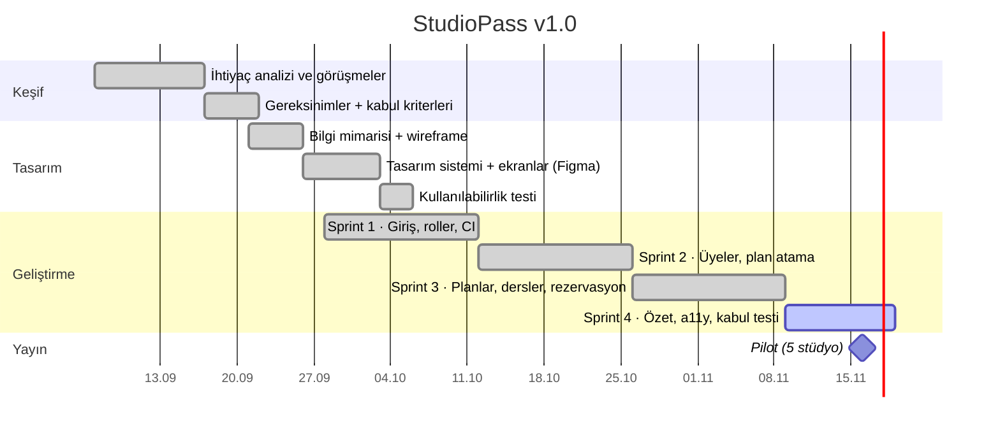

# Proje Planı — StudioPass v1.0

## Kilometre taşları

## RACI

| İş | Ürün Sahibi | Mimar | Geliştirici (insan + YZ) | Bağımsız denetçi | Koordinasyon / QA | Müşteri |
|---|---|---|---|---|---|---|
| Gereksinim ve kabul kriterleri | **A** | C | C | I | R | C |
| Figma tasarımları | A | C | I | C | R | C |
| API ve web geliştirme | I | A | **R** | C | C | – |
| Kod incelemesi | I | A | R | **R** | C | – |
| Kabul testi ve hata raporu | C | I | C | I | **A/R** | I |
| Haftalık rapor, toplantı notları | I | I | I | I | **A/R** | I |
| Sürüm notu ve yayın kararı | **A** | C | I | C | R | I |

R: Yapan · A: Hesap veren · C: Danışılan · I: Bilgilendirilen

## İletişim planı

| Paydaş | Kanal | Sıklık | İçerik |
|---|---|---|---|
| Müşteri (stüdyo sahibi) | E-posta + 30 dk görüntülü demo | Haftalık | Haftalık rapor, demo, karar talepleri |
| Ekip | Slack `#studiopass` | Günlük | Engeller, PR'lar |
| Ekip | GitHub Projects | Sürekli | Tek gerçek kaynak: kim neyi bekliyor |
| Pilot kullanıcılar | WhatsApp destek hattı | Pilot süresince | Hata bildirimi → issue |
